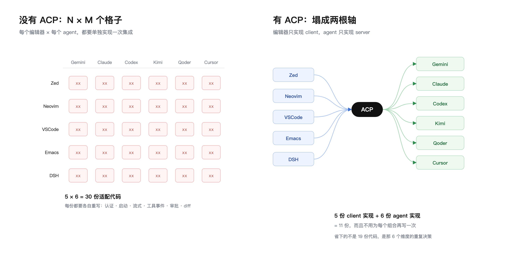
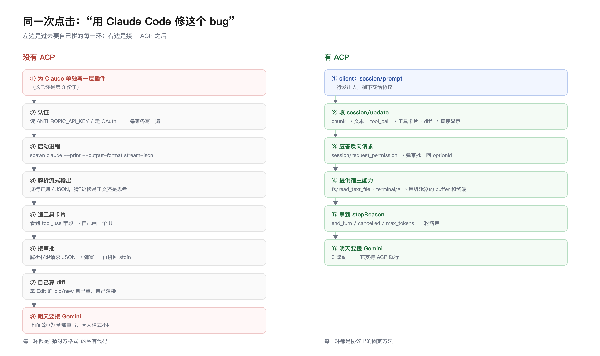
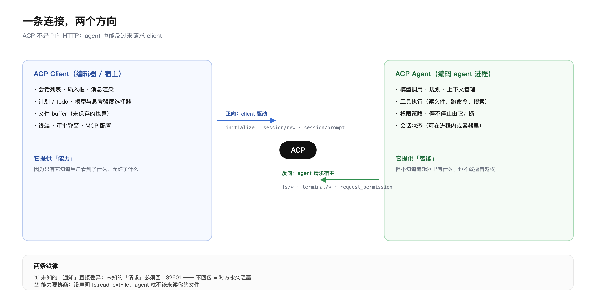

# ACP（Agent Client Protocol）详解

> 依据：本机 `@agentclientprotocol/sdk@1.4.0` 的 `schema/schema.json` 与生成类型（权威 wire 定义）、`@deepseek-ai/dsh-acp` 中文 README，以及 ACP 官方站点（agentclientprotocol.com）的公开描述。
> 写作时间 2026-10-29。协议仍在演进，标 **⚠ 草案/不稳定** 的部分随时可能变。

---

## 0. 一分钟版

**ACP 是"编辑器 ↔ 编程 Agent"之间的标准协议。**

- 定位：让任何编辑器/IDE 能驱动任何编码 agent（Claude Code、Gemini CLI、Codex、Kimi…），不需要为每个组合写一次集成。
- 形态：**JSON-RPC 2.0**，默认走 **stdio 上的 NDJSON**（一行一条消息），也支持 Streamable HTTP + SSE、WebSocket。
- 两端：**Client**（编辑器/宿主，负责 UI、文件、终端、审批）与 **Agent**（跑模型、调工具、改代码）。
- 版本：`protocolVersion = 1`（稳定）；`protocolVersion = 2` 已进入实验草案。
- 与 MCP 的关系：不是竞争，是**垂直分工**——MCP 接"工具/数据"，ACP 接"整个 agent 进程"。

一句话记法：**ACP ≈ LSP 之于语言服务器，但对象是 AI 编码 agent。** 这不是修辞——消息模型、`$/` 控制方法前缀、能力协商、`_meta` 扩展位，都是照着 LSP 的路子来的。

---

## 1. 它解决什么问题：N×M 集成地狱

### 1.1 没有 ACP 的世界：一手一手对出来的矩阵

假设有 5 个编辑器、6 个 agent。要让"每个编辑器都能用每个 agent"，需要实现的是**矩阵里的每一个格子**：



*图 1 · 左：N×M 个格子，每格一份适配；右：塌成两根轴，5 + 6 = 11 份*

> **关于图**：官方 ACP 文档（`agentclientprotocol.com`）和 Zed 的博客**目前都没有架构图**——只有文字步骤和一段演示视频。所以本文这三张图是按 ACP v1 的 schema 加上本机实测报文自己画的，源文件在 `docs/acp-diagrams/`。

**"xx" 不是几百行胶水，而是一整套重复劳动。** 每份适配都要自己解决下面这 6 件事，而且每个 agent 的解法都不一样：

| 每份适配都要重写 | 为什么无法复用 |
| --- | --- |
| **认证** | 有的读 `ANTHROPIC_API_KEY`，有的走 OAuth，有的读配置文件 |
| **启动与进程管理** | `claude --print`、`gemini`、`codex exec`，参数和生命周期各不相同 |
| **流式解析** | 有的喷 JSONL，有的喷带 ANSI 的文本，字段名各写各的 |
| **工具事件** | "工具调用"在哪、叫什么、怎么配对结果，每家都要单独猜 |
| **审批** | 权限请求的格式、可选项语义、超时行为，全不统一 |
| **diff 渲染** | 拿到的是 `old/new` 还是 patch 还是纯文本，取决于对方心情 |

**这就是"地狱"的真正含义**：不是 30 份代码，而是 **30 份 × 6 个维度 = 180 个各自为政的实现**，任何一个 agent 改输出格式，它那一列全得跟着改。

### 1.2 没有 ACP 时，具体是怎么做的

真实世界里只有三种做法，每一种都有硬伤：

```text
路径 A：编辑器内嵌 SDK —— 把 agent 当库用
  编辑器插件 ──► agent 的私有 SDK ──► 内部实现
  硬伤：只能在同语言/同进程用；SDK 一升级就断；拿不到 CLI 的真实行为

路径 B：shell 调 CLI + 解析文本 —— 最常见
  编辑器插件 ──► spawn "claude -p --output-format stream-json"
              ──► 逐行正则/JSON 猜状态
              ──► 拼成聊天记录
  硬伤：靠猜。字段一改就崩；审批要自己拼回 stdin；工具事件基本丢

路径 C：自研私有协议 —— 大厂才做
  编辑器插件 ◄──[自定义 JSON-RPC]──► 自建 agent 桥接层
  硬伤：只服务自家产品，别人接不进来；等于每家都造一个"自己的 ACP"
```

### 1.3 一次点击，两种命运



*图 2 · 左边每一环都在"猜对方的格式"，右边每一环都是协议里的固定方法*

### 1.4 ACP 之后：矩阵塌成两根轴

见 图 1 右半：**5 个编辑器走同一套 client 协议，6 个 agent 走同一套 server 协议，5 + 6 = 11 份，而不是 30 份。**


省下的不只是 19 份代码，更是**那 6 个维度的重复决策**：认证、流式、工具、审批、diff、会话——全部变成协议里的固定方法。

> 现实中的数据也印证了这一点：Cursor 原生内置 `agent acp`，Claude Code / Codex 由官方组织维护适配器 —— 厂商已经帮生态把"那一列"写完了。

**关键收益不只是"少写代码"**，而是三件事：

1. **能力不降级**：编辑器不再把 agent 降格成"一个模型 API"。agent 的工具调用、计划、diff、审批、斜杠命令、模型/思考强度选择，都能原样呈现（而不是被宿主翻译成自己那套概念）。
2. **权限语义属于 agent**：谁有权改文件、跑命令，由 agent 自己声明，宿主只负责问用户。
3. **agent 与宿主解耦**：agent 可以是任意语言、任意进程，甚至跑在容器里；宿主不必理解它内部怎么实现。

---

## 2. 角色：谁是谁

| 角色 | 谁扮演 | 典型职责 |
| --- | --- | --- |
| **Client** | 编辑器 / IDE / 宿主 harness（Zed、Neovim 客户端、DSH 这类宿主） | 渲染会话、提供文件读写、提供终端、弹权限审批、决定 MCP servers |
| **Agent** | 编码 agent 进程（或其 ACP 适配器） | 跑模型、规划、调用工具、流式输出、请求权限 |

两层分工，一条双向管道：



*图 3 · 上箭头是正向驱动，下箭头是 agent 反向请求宿主——同一条 stdio 连接*


两条容易搞混的设定，必须记牢：

1. **方向是"客户端主动、agent 响应"**：`initialize`、`session/new`、`session/prompt` 都是 **client → agent** 的请求。agent 想反过来要东西（读文件、跑命令、要审批），走的是**反向请求**——同一条连接上，agent 也能发 request，client 必须应答。所以这不是 HTTP 式的单向调用，而是**双向对等通道**。
2. **agent 不直接碰磁盘**：按协议设计，agent 读写文件、跑命令都**应该通过 client 的 `fs/*`、`terminal/*` 方法**，这样"编辑器里看到的 buffer"和"agent 看到的文件"是同一份真相。**但这不是强制的**——agent 完全可以自己读盘（很多 CLI agent 就是这样，因为它们本来就是独立进程）。协议层面 client 无法强制，只能靠"是否提供 fs/terminal 能力"来影响它。

---

## 3. 协议底座

### 3.1 消息格式

标准 JSON-RPC 2.0：

```json
{"jsonrpc":"2.0","id":1,"method":"session/prompt","params":{...}}
{"jsonrpc":"2.0","id":1,"result":{"stopReason":"end_turn"}}
{"jsonrpc":"2.0","method":"session/update","params":{...}}   ← 通知，无 id
```

- 请求/响应/通知三种，语义照 JSON-RPC 规范。
- 错误用标准 `error: {code, message, data}`；ACP 额外定义了业务错误码（如 `-32000` 认证必需、`-32800` 请求被取消）。
- **`$/` 前缀**是协议自身的控制方法（借自 LSP）：目前只有 `$/cancel_request`。
- **`_meta`**：几乎所有结构体都带这个自由字段，用于给双方挂私有元数据。规范明确要求"实现不得对里面的值做任何假设"。

### 3.2 传输

| 传输 | 状态 | 说明 |
| --- | --- | --- |
| **stdio（NDJSON）** | 标准 | 最常见。一行一条 JSON，`stdout` 只能跑协议流量，日志必须走 `stderr` |
| **Streamable HTTP + SSE** | SDK 已提供（`createHttpStream`） | POST 发 client 消息，SSE GET 收 server 消息；默认带 cookie 做会话亲和 |
| **WebSocket** | SDK 已提供 | 双向，适合浏览器端宿主 |

stdio 模式下，**agent 就是 client spawn 出来的子进程**。这带来一个重要后果：**进程生命周期 = 会话生命周期**，agent 崩溃/退出时宿主必须自己处理后事（重连、重启、状态恢复）。HTTP/WS 模式则允许 agent 作为常驻服务、一个连接多路复用多个会话。

### 3.3 版本协商与能力协商

握手第一步永远是 `initialize`：

- 双方各报 **`protocolVersion`**（整数，只在破坏性变更时递增）和 **capabilities**。
- 约定：agent 如果支持 client 的版本就原样返回，否则返回自己支持的最高版本；**client 看到不认识的版本应当断开**——不做"猜测式降级"。
- 能力协商是**唯一**判断"某个可选特性能不能用"的依据。不要用版本号去推断能力，也不要假设某个方法一定存在。

能力位和方法是**一一对应**的，没声明就永远不会被调用：

```text
  client 声明（clientCapabilities）      agent 才敢调用
  ────────────────────────────────────────────────────────────────
  fs.readTextFile             ──►  fs/read_text_file
  fs.writeTextFile            ──►  fs/write_text_file
  terminal: true              ──►  terminal/create | output | wait_for_exit | kill | release
  elicitation.form            ──►  elicitation/create (mode=form)
  「不声明」                  ──►  对方不应调用，也调不动

  agent 声明（agentCapabilities）        client 才敢用
  ────────────────────────────────────────────────────────────────
  loadSession: true           ──►  session/load
  sessionCapabilities.list    ──►  session/list
  promptCapabilities.image    ──►  prompt 里能否带图片块
```

> 这就是为什么 ACP 能在**不升版本号**的前提下持续加功能：新特性一律挂在能力位后面，老实现的短板就是"少几个 capability"，而不是"协议不兼容"。

---

## 4. 方法全景

> 以下取自 `schema` 的 `AGENT_METHODS` / `CLIENT_METHODS` / `PROTOCOL_METHODS`（v1）。**标 ⚠ 的是 schema 中标注 UNSTABLE 的实验项。**

### 4.1 Client → Agent（宿主驱动 agent）

| 方法 | 作用 | 能力门 |
| --- | --- | --- |
| `initialize` | 握手、交换版本与能力 | 必需 |
| `authenticate` | 用 `authMethods` 里的某个方法登录 | 按 `authMethods` |
| `session/new` | 新建会话（`cwd`、附加根目录、MCP servers） | 必需 |
| `session/prompt` | 发一轮用户输入，阻塞到该轮结束 | 必需 |
| `session/cancel` | 取消当前轮（通知，非请求） | 必需 |
| `session/set_mode` | 切换会话模式（如 ask / code / architect） | 按 `modes` |
| `session/set_config_option` | 改模型、思考强度等配置项 | 按 `configOptions` |
| `session/load` | 加载已有会话并**回放历史**（放 `session/update` 通知里） | `loadSession` |
| `session/resume` | 恢复持久会话但不回放旧更新 | `sessionCapabilities` |
| `session/list` | 分页列出可恢复会话 | `sessionCapabilities.list` |
| `session/delete` | 删除会话 | `sessionCapabilities.delete` |
| `session/close` | 收尾关闭，释放 agent 作用域 | `sessionCapabilities` |
| `session/fork` | 从某会话分叉 | ⚠ |
| `mcp/message` | 把 MCP 消息经 ACP 隧道转发 | 按 `mcpCapabilities` |
| `logout` | 登出 | 按 `auth` |
| `providers/list` `providers/set` `providers/disable` | 运行时配置模型供应商 | ⚠ |
| `nes/start` `nes/suggest` `nes/accept` `nes/reject` `nes/close` | Next Edit Suggestions（行内补全位） | ⚠ |
| `document/didOpen` `didChange` `didClose` `didSave` `didFocus` | 把编辑器文档状态推给 agent | ⚠ |

### 4.2 Agent → Client（agent 反向要东西）

| 方法 | 作用 | 能力门 |
| --- | --- | --- |
| `session/update` | **单向通知**：流式输出、工具进度、计划、用量… | 必需 |
| `session/request_permission` | 请求审批某个工具调用 | 必需 |
| `fs/read_text_file` | 读文件（走编辑器缓冲） | `fs.readTextFile` |
| `fs/write_text_file` | 写文件 | `fs.writeTextFile` |
| `terminal/create` `terminal/output` `terminal/wait_for_exit` `terminal/kill` `terminal/release` | 用宿主的终端跑命令 | `terminal: true` |
| `mcp/connect` `mcp/message` `mcp/disconnect` | 与 client 侧 MCP server 通信 | ⚠（v1.4 新增） |
| `elicitation/create` `elicitation/complete` | 结构化"追问用户"表单 | `elicitation` |

### 4.3 协议自身

| 方法 | 作用 |
| --- | --- |
| `$/cancel_request` | 取消任意在途请求（JSON-RPC 通用取消） |

**判断一条消息是哪个方向**，靠的就是"这个方法属于 AGENT_METHODS 还是 CLIENT_METHODS"。写客户端时这是第一道分叉。

---

## 5. 一次会话的完整生命周期

```
Client                                  Agent
  │  initialize (version + caps)          │
  │──────────────────────────────────────►│
  │◄──────────────────────────────────────│  能力、authMethods、agentInfo
  │  authenticate (可选)                   │
  │──────────────────────────────────────►│
  │  session/new {cwd, mcpServers}         │
  │──────────────────────────────────────►│
  │◄──────────────────────────────────────│  sessionId + modes + configOptions
  │  session/prompt {content blocks}       │
  │──────────────────────────────────────►│
  │◄──── session/update (chunk) ───────────│  流式文本/思考
  │◄──── session/update (tool_call) ───────│  工具开始
  │◄──── fs/read_text_file ────────────────│  agent 反向请求（client 应答）
  │──── read_text_file result ────────────►│
  │◄──── session/request_permission ───────│  需要审批
  │──── selected / cancelled ─────────────►│
  │◄──── session/update (tool_call_update) │  工具完成 + diff
  │◄──── session/update (agent chunk) ─────│  继续输出
  │◄──────────────────────────────────────│  prompt result {stopReason}
  │  session/prompt (下一轮) …             │
```

### 5.1 `initialize`

```json
{
  "jsonrpc": "2.0", "id": 0, "method": "initialize",
  "params": {
    "protocolVersion": 1,
    "clientCapabilities": {
      "fs": { "readTextFile": true, "writeTextFile": true },
      "terminal": true
    },
    "clientInfo": { "name": "zed", "version": "0.190.0" }
  }
}
```

```json
{
  "jsonrpc": "2.0", "id": 0,
  "result": {
    "protocolVersion": 1,
    "agentCapabilities": {
      "loadSession": true,
      "promptCapabilities": { "image": true, "audio": false, "embeddedContext": true },
      "mcpCapabilities": { "http": true, "sse": true },
      "sessionCapabilities": { "list": {}, "delete": {}, "additionalDirectories": {} }
    },
    "authMethods": [{ "id": "gemini-login", "name": "Log in with Google" }],
    "agentInfo": { "name": "gemini-cli", "version": "0.64.0" }
  }
}
```

要点：
- `clientCapabilities.fs` / `terminal` **不声明，agent 就不该调用**对应方法。这是"能力协商"的实际用途。
- `promptCapabilities` 决定 client 能不能往 prompt 里塞图片、音频、内嵌资源。
- `authMethods` 是**登录方式的描述**，两种：`type: "terminal"`（让宿主跑一条命令引导登录）与 `type: "agent"`（agent 自己走 `authenticate` 流程）。

### 5.2 `session/new`

```json
{
  "jsonrpc": "2.0", "id": 1, "method": "session/new",
  "params": {
    "cwd": "/Users/me/project",
    "additionalDirectories": ["/Users/me/shared-lib"],
    "mcpServers": [
      { "name": "fs", "command": "/usr/bin/mcp-fs", "args": ["--root","."], "env": [] },
      { "type": "http", "name": "docs", "url": "https://example.com/mcp",
        "headers": [{ "name": "Authorization", "value": "Bearer …" }] }
    ]
  }
}
```

返回 `sessionId`，外加两份"活配置"：
- **`modes`**：`{ currentModeId, availableModes: [{id, name, description}] }` —— 粗粒度的行为模式。
- **`configOptions`**：`[{ id, name, category, type: "select"|"boolean", currentValue, options }]` —— 细粒度开关。`category` 有约定值 `mode` / `model` / `model_config` / `thought_level`，**仅供 UI 摆放与快捷键用，不能拿来做正确性判断**；以 `_` 开头的 category 留给自定义。

这就是为什么好的客户端能把"模型""思考强度"渲染成宿主的原生控件，而不用硬编码任何 agent 的模型名。

### 5.3 `session/prompt`：一轮对话

```json
{
  "jsonrpc": "2.0", "id": 2, "method": "session/prompt",
  "params": {
    "sessionId": "sess_abc",
    "prompt": [
      { "type": "text", "text": "把这个组件的样式改成 tailwind" },
      { "type": "resource_link", "uri": "file:///Users/me/project/src/Button.tsx",
        "name": "Button.tsx", "mimeType": "text/typescript" }
    ]
  }
}
```

**`session/prompt` 是一个长请求**：它不返回"第一句话"，而是**阻塞到整轮结束**才 resolve。期间所有内容通过 `session/update` 通知流式推送。这一点如果理解错，客户端就会写成"等回复"而不是"订阅流"。

期间可能出现的 `session/update` 变体（`sessionUpdate` 判别字段）：

| 值 | 含义 |
| --- | --- |
| `user_message_chunk` | 用户消息回显（`load` 回放时用得多） |
| `agent_message_chunk` | 助手正文增量（带 `messageId`，变化即新消息） |
| `agent_thought_chunk` | 思考/推理增量 |
| `tool_call` / `tool_call_update` | 工具调用创建/更新 |
| `plan` / `plan_update` / `plan_removed` | 计划条目（todo 式） |
| `available_commands_update` | agent 声明的斜杠命令变了 |
| `current_mode_update` | 模式被切了 |
| `config_option_update` | 配置项状态变了 |
| `session_info_update` | 会话标题/元信息变了 |
| `usage_update` | 上下文/token 用量 |
| `compaction_update` / `compaction_summary_chunk` | 上下文压缩进度与摘要 |

> 注意 `session/update` 是**通知**，没有 id、不期待响应。客户端收到即渲染，出错也不能回 `error`。

### 5.4 agent 反向调用：文件与终端

```json
{"jsonrpc":"2.0","id":7,"method":"fs/read_text_file",
 "params":{"sessionId":"sess_abc","path":"/Users/me/project/src/Button.tsx",
           "line":1,"limit":400}}
```

```json
{"jsonrpc":"2.0","id":8,"method":"terminal/create",
 "params":{"sessionId":"sess_abc","command":"pnpm","args":["test"],
           "cwd":"/Users/me/project","outputByteLimit":1048576}}
```

设计意图很重要：**把"文件"和"终端"抽象成宿主的能力，agent 就只是"决策者"**。
- 编辑器里未保存的 buffer 也能被 agent 读到（真实来源是宿主，不是磁盘）。
- 命令跑在宿主的终端里，用户看得见、可以接管、可以用宿主自己的沙箱策略。
- 宿主可以拒绝、可以脱敏、可以审计。

但现实是**大量 agent 自带 file/exec 工具，并不走这条路**（Claude Code、Codex 这类独立 CLI 就是自己读盘的）。所以 `fs/*`、`terminal/*` 在真实生态里是"可选增强"，不是"必经之路"。协议没有强制手段——这是 ACP 有意接受的一个口子。

### 5.5 权限审批

```json
{"jsonrpc":"2.0","id":9,"method":"session/request_permission",
 "params":{
   "sessionId":"sess_abc",
   "toolCall":{"toolCallId":"tc_1","title":"写入 src/Button.tsx","kind":"edit","status":"pending"},
   "options":[
     {"optionId":"allow_once","name":"允许一次","kind":"allow_once"},
     {"optionId":"allow_always","name":"总是允许","kind":"allow_always"},
     {"optionId":"reject_once","name":"拒绝","kind":"reject_once"}
   ]}}
```

回应只有两种形态：

```json
{"jsonrpc":"2.0","id":9,"result":{"outcome":{"outcome":"selected","optionId":"allow_once"}}}
{"jsonrpc":"2.0","id":9,"result":{"outcome":{"outcome":"cancelled"}}}
```

要点：
- **选项是 agent 给的，名字也是 agent 给的**。`kind` 只是 UI 提示（用什么图标、危险色），不代表宿主可以自行决定语义。
- 宿主**可以自动应答**（比如"全部允许"模式），协议允许；这等于把安全责任明确交给了宿主配置。
- `cancelled` ≠ `reject`：前者是"用户没答/被打断"，后者是明确的拒绝选项。

### 5.6 一轮怎么结束

`session/prompt` 返回 `{ "stopReason": … }`：

| stopReason | 含义 |
| --- | --- |
| `end_turn` | 正常说完 |
| `max_tokens` | 撞到 token 上限 |
| `max_turn_requests` | 撞到最大请求数（agent 侧策略上限） |
| `refusal` | 模型拒绝 |
| `cancelled` | 被 `session/cancel` 取消 |

取消是**通知**：`{"jsonrpc":"2.0","method":"session/cancel","params":{"sessionId":"sess_abc"}}`。语义是"尽力停止"——agent 应当停下并让 `session/prompt` 以 `cancelled` 结束。要取消别的在途请求（比如某个 `fs/*`），用 `$/cancel_request` + 对应 id。

### 5.7 会话复用与恢复

| 方法 | 语义差异（容易混） |
| --- | --- |
| `session/load` | **带回放**：把历史消息以 `user_message_chunk` / `agent_message_chunk` 重新推一遍，客户端重建 UI |
| `session/resume` | **不回放**：恢复上下文继续用，UI 靠客户端自己已有数据 |
| `session/list` | 列出可恢复会话，分页，值不值得显示取决于 `sessionCapabilities.list` |
| `session/close` | drain 在途输出、释放资源；不等于删除，之后仍可 `load` |
| `session/delete` | 真删 |

对 stdio 传输这条尤其重要：**进程死了，上下文就没了**。所以要"断电续聊"，agent 必须自己做持久化，并实现 `load`/`resume`。HTTP/WS 传输下重连也一样——ACP v1 **不会补发断连期间的消息**，只能新建连接 → `initialize` → `session/load` 重新拉。

---

## 6. 内容模型：ContentBlock

统一的内容块，prompt 和 update 共用同一套：

| `type` | 结构 | 备注 |
| --- | --- | --- |
| `text` | `{ text }` | 基线，所有 agent 必须支持 |
| `image` | `{ data(base64), mimeType, uri? }` | 需 `promptCapabilities.image` |
| `audio` | `{ data, mimeType }` | 需 `promptCapabilities.audio` |
| `resource_link` | `{ uri, name, mimeType? }` | 基线，**引用而非内容**：agent 自己去取 |
| `resource` | `{ resource: { uri, mimeType, text|blob } }` | 内嵌内容，需 `embeddedContext` |

设计取舍很清楚：**优先传引用（`resource_link`），必要时才内嵌（`resource`）**。引用省 token、省带宽、不会过期；内嵌适合 agent 拿不到的资源（未保存的 buffer、私有 URL）。

所有块都支持 `annotations`（`audience` / `lastModified` / `priority`）和 `_meta`。

---

## 7. 工具调用模型

`tool_call` 只是"声明"，后续全部用 `tool_call_update` 增量更新（只有 `toolCallId` 必填，其余字段"有则改，无则不动"）。

```
{ toolCallId, title, kind?, status?, content?, locations?, rawInput?, rawOutput? }
```

- **`kind`** 是给 UI 分类用的语汇：`read` `edit` `delete` `move` `search` `execute` `think` `fetch` `switch_mode` `other`。客户端据此选图标、决定是否展开 diff。
- **`status`**：`pending` → `in_progress` → `completed` | `failed`。
- **`content`** 是三选一：
  - `{type:"content", content: ContentBlock}` —— 普通输出
  - `{type:"diff", path, oldText?, newText}` —— **结构化 diff**，这是 ACP 的杀手锏，客户端能渲染成真正的代码审阅视图
  - `{type:"terminal", terminalId}` —— 关联一个终端，输出流在 `terminal/output` 里
- **`locations`**：受影响的文件位置，用来做"跟随跳转"。

对比"agent 只吐一段 markdown"，这个模型让宿主能提供**原生的工具活动 UI**（可折叠、可跳转、可审 diff），而不是让用户读 agent 的日志。

---

## 8. 信任与安全边界

这是 ACP 最容易被误解的部分，说清楚四点：

1. **ACP 不带认证**。stdio 模式下安全边界是"谁 spawn 了这个进程"。规范里的 `authenticate` 是给 agent 自己的上游服务登录用的，不是 ACP 传输层的鉴权。
2. **agent 是"受信代码"**。它拿到 `cwd` 就能读整个工作区（如果它自己读盘）；`fs/*`、`terminal/*` 的约束力来自 client 的实现质量，不是协议的强制。
3. **宿主的沙箱管不到 agent**。宿主自己的"只读/工作区写入/完全权限"策略，对**外部 agent 进程**没有约束力——真正生效的是 agent 自己的权限模式。做产品时必须在 UI 上讲清楚，否则用户会以为"宿主的只读模式"保护了他。
4. **权限提示是"建议性"的**。`session/request_permission` 只在 agent 愿意问的时候出现；一个不老实（或设计如此）的 agent 可以从不发这个请求。

HTTP/WS 传输把边界外扩了，所以 SDK 才配了 `headers`、cookie 亲和、`allowInsecurePrivateNetwork` 这种显式开关——**从 stdio 换到网络传输，安全模型整个变了**，不要顺手切换。

---

## 9. 与 MCP 的关系：互补，不是替代

| | MCP | ACP |
| --- | --- | --- |
| 连接对象 | agent ↔ **工具/数据源** | 编辑器 ↔ **整个 agent** |
| 粒度 | 一次工具调用 | 一个会话、一轮对话、一个进程 |
| 谁实现 | server（工具方） | agent 与 client 两侧都要实现 |
| 状态 | 基本无会话语义 | 有会话、有模式、有权限 |

它们**在同一套栈里叠起来**，ACP 在三个位置复用了 MCP：

1. **`session/new` 里注入 MCP servers**：宿主可以把"自己这边的" MCP server 交给 agent 用（`stdio` / `http` / `sse`），于是编辑器扩展能变成 agent 的工具。这是最常用的复用点。
2. **`mcp/message` 隧道**：把 MCP 的 JSON-RPC 塞进 ACP 消息里转发，等于在 ACP 上跑一条 MCP 子通道。
3. **`type: "acp"` 的 MCP server**（⚠ v1.4 新增）：把一个 **ACP agent 本身**当成 MCP server 接进来——agent 之间互相提供工具。

顺带一提：`ContentBlock` 的结构基本照搬 MCP 的 content 类型（text/image/audio/resource/resource_link），这让"工具输出"和"对话内容"能无损互转。

---

## 10. 扩展机制

三层，从轻到重：

1. **`_meta`**：任意结构体都能挂。双方私下约定，规范保证不解析、不破坏。
2. **自定义方法**：用自定义前缀（约定 `_` 开头，如 `_myvendor/foo`）。未知方法必须能被对方"礼貌地忽略或回错误"，不能崩连接。
3. **能力位**：任何可选特性都要有对应的 capability 字段，**先协商再使用**。这是 ACP 能在不升 `protocolVersion` 的前提下持续加功能的唯一原因。

规范对"不支持"的要求很明确：**要么不公布，要么收到就回 `method not found`，绝不静默丢**。这也是为什么很多实现（如 `@deepseek-ai/dsh-acp`）宁可显式拒绝 `session/load`、`mode`、`terminal`，也不假装支持。

---

## 11. ⚠ ACP v2 草案在改什么

`protocolVersion = 2` 已在 SDK 里以 `@agentclientprotocol/sdk/experimental/v2` 提供，SDK 明确警告"wire 协议可能在不兼容的情况下变化"。从 schema 能看出几条方向性变化：

- **版本必须精确匹配**（v2 客户端发 `1` 会被直接拒），不再有"协商降级"。
- **client 侧的 `fs/*` 与 `terminal/*` 方法消失**：终端输出改为由 agent 通过 `session/update`（`terminal_update`、`terminal_output_chunk`）**汇报**，宿主只负责渲染。等于把"谁拥有终端"从 client 挪到了 agent——更贴近现实中独立 CLI agent 的行为。
- **补全/批注类能力进来**：`document/didOpen|didChange|didClose|didSave|didFocus` 让 agent 知道编辑器里的文档状态，服务行内建议（NES）。
- **认证拆细**：`auth/login` / `auth/logout` 取代 `authenticate` / `logout`。
- **更新类型更丰富**：多出 `agent_message`、`user_message`（整段而非 chunk）、`state_update`、`tool_call_content_chunk`，说明正在区分"增量流"与"已定稿消息"。
- **计划与压缩语义强化**：`plan_update` / `plan_removed`、`compaction_update` / `compaction_summary_chunk` 从实验转正的味道。

**结论**：现在做产品就按 v1（`protocolVersion: 1`）实现；架构上留出"传输可换、终端归属可换"的抽象，等 v2 定稿再切。

---

## 12. 命名歧义：ACP 不止一个

搜 "ACP" 会撞到三个东西，别搞混：

| 缩写 | 全称 | 干什么 | 关系 |
| --- | --- | --- | --- |
| **ACP**（本文） | Agent Client Protocol | 编辑器 ↔ 编码 agent | Zed 发起；与 MCP 互补 |
| A2A | Agent2Agent Protocol | **agent ↔ agent** 协作（跨组织、任务委派） | 已捐给 Linux Foundation；和 ACP 分层不同 |
| ACP（旧） | Agent Communication Protocol | IBM/BeeAI 早期的 agent 间通信协议 | **已并入 A2A**，不要再用这个名字做新项目 |

判别方法：**如果语境里出现"编辑器/IDE/插件/补全/diff"，指的是 Agent Client Protocol；如果出现"多 agent 编排/跨厂商协作/任务市场"，指的是 A2A。**

---

## 13. 生态：谁在说 ACP

**客户端（宿主）**
- Zed（协议发起方，原生支持，体验最完整）
- 以及 JetBrains 系、Neovim、Emacs 等编辑器的社区 ACP 客户端；还有把 ACP 当"插件接口"用的宿主（例如把外部 agent 接进自家聊天壳的实现）

**agent 侧**——生态其实比客户端热得多。绝大多数 agent 是**先有 CLI，再加 ACP 适配器**，两种形态：

| 形态 | 例子 | 说明 |
| --- | --- | --- |
| 原生 `--acp` 子命令 | `gemini --acp`、`kimi acp`、`qodercli --acp`、`cline --acp`、`copilot --acp`、`opencode`、`qwen --acp --experimental-skills` | agent 自己实现 ACP |
| 独立适配器包（npx 拉起） | `claude-agent-acp`、`codex-acp`、`pi-acp`、`goose`、`auggie --acp` | 把"没有 ACP 的 agent"包一层 |

所以"**Claude Code 支持 ACP**"这句话的准确含义通常是：**存在一个叫 `claude-agent-acp` 的适配器**，它 spawn Claude Code 并把它的输出翻译成 ACP。这也解释了为什么这类集成总会漏掉一些原生能力（适配器翻译不出来的东西就是没有）。

---

## 14. 动手：两端最小骨架

用官方 SDK（TypeScript，`@agentclientprotocol/sdk@1.4.0`）。API 形状很统一：**按 ACP 方法名注册 handler**，handler 拿到的 context 里既有 `params`，也有"调对方"的句柄。

**Agent 侧**

```ts
import { agent, ndJsonStream } from "@agentclientprotocol/sdk";

agent({ name: "my-agent" })
  .onRequest("initialize", () => ({
    protocolVersion: 1,
    agentCapabilities: { promptCapabilities: { image: false } },
  }))
  .onRequest("session/new", () => ({ sessionId: crypto.randomUUID() }))
  .onRequest("session/prompt", async ({ params, client }) => {
    // ① 单向通知：流式输出（这里是 client 那一侧的方法名）
    await client.notify("session/update", {
      sessionId: params.sessionId,
      update: {
        sessionUpdate: "agent_message_chunk",
        content: { type: "text", text: "thinking…" },
      },
    });

    // ② 反向请求：读文件（需要 client 声明了 fs.readTextFile）
    const { content } = await client.request("fs/read_text_file", {
      sessionId: params.sessionId,
      path: "/Users/me/project/src/a.ts",
    });

    // ③ 不声明 loadSession / sessionCapabilities，就别实现对应方法
    return { stopReason: "end_turn" };
  })
  .onNotification("session/cancel", ({ params }) => {
    // 尽力停止当前轮
  })
  .connect(ndJsonStream(process.stdout, process.stdin));  // stdout 只跑协议，日志走 stderr
```

**Client 侧**

```ts
import { client, ndJsonStream } from "@agentclientprotocol/sdk";
import { spawn } from "node:child_process";
import { readFile } from "node:fs/promises";

const proc = spawn("my-agent", [], { stdio: ["pipe", "pipe", "inherit"] });
const stream = ndJsonStream(proc.stdout, proc.stdin);

await client({ name: "my-editor" })
  // 收流：session/update 是通知，不是请求，回不了错误
  .onNotification("session/update", ({ params }) => render(params.update))
  // 审批：选项是 agent 给的，不要自己发明语义
  .onRequest("session/request_permission", ({ params }) => ({
    outcome: { outcome: "selected", optionId: params.options[0].optionId },
  }))
  // agent 反向要文件时才被调用
  .onRequest("fs/read_text_file", async ({ params }) => ({
    content: await readFile(params.path, "utf8"),
  }))
  .connectWith(stream, async (cx) => {
    await cx.request("initialize", {
      protocolVersion: 1,
      clientCapabilities: { fs: { readTextFile: true } },   // 不声明，agent 就不该调
    });

    await cx
      .buildSession(process.cwd())        // = session/new 的 cwd
      .withMcpServer({ name: "fs", command: "/usr/bin/mcp-fs", args: [], env: [] })
      .withSession(async (session) => {   // 自动管理更新路由并 dispose
        const done = session.prompt("把 Button 的样式改成 tailwind");
        const text = await session.readText();   // 只取 agent_message_chunk
        console.log(text, (await done).stopReason);
      });
  });
```

> 想快速验证实现对不对：拿一个已知可用的 ACP 客户端（如 Zed）去连你的 agent；或者用现成 agent（`gemini --acp`）去测你的客户端。**不要两端都自己写**——那是调试地狱。

---

## 15. 设计取舍与常见坑

**协议层面的取舍**
- **一个 prompt 一次一个会话**：`session/prompt` 在同一会话里必须串行。要并发就多开会话，别指望一个会话里并行两轮。
- **长请求 + 通知流**：prompt 阻塞到整轮结束，期间靠通知。这意味着**断线就等于丢中间态**（v1 不补发）。
- **无内建多模态/无内建工具**：ACP 不定义工具 schema，工具是 agent 内部的事；ACP 只定义"工具调用的**展示**"。
- **不定义模型 API**：agent 用哪个模型、怎么调，协议完全不关心。这正是它比"统一模型 API"更有生命力的地方。

**实现时最容易踩的**
1. **把 `session/update` 当成请求回包**：它是通知，回不了错误；渲染逻辑必须容错、可乱序（同一会话内有序，跨会话不保证）。
2. **用版本号猜能力**：不行。能力协商是唯一依据。
3. **日志写到 stdout**：stdio 模式下会直接污染协议流，解析器当场炸。日志一律 stderr。
4. **忘记 `session/cancel` 是通知**：发成请求会等一个永远不会来的响应。
5. **以为 `session/load` 会恢复 UI**：它只是把历史当 update 重放一遍，客户端要自己"识别并重建"，否则会出现消息重复。
6. **适配器能力缺失被误判成 bug**：模型列表短、没有某种审批模式，往往是适配器没翻译出来，不是 agent 本身不行。
7. **在宿主里做"权限翻译"**：把 agent 的 `Manual/Accept edits/Plan/Auto/Bypass` 硬映射成宿主自己的三档权限，会立刻产生语义谎言。要么原样透出，要么明确告知"此模式由 agent 自管"。

---

## 16. 速查

```
传输   : stdio NDJSON（标准） / Streamable HTTP+SSE / WebSocket
版本   : protocolVersion 1（稳定）  2（⚠ 草案）
握手   : initialize → options 由 capabilities 决定
会话   : session/new → session/prompt（长请求）→ session/update（通知流）→ stopReason
反向   : fs/* · terminal/* · session/request_permission · elicitation/* · mcp/*
取消   : session/cancel（通知） · $/cancel_request（通用）
恢复   : session/load（回放） · session/resume（不回放） · session/list · session/close
配置   : modes（粗） · configOptions（细，category=mode|model|thought_level）
扩展   : _meta · 自定义前缀方法 · capability 位
```

**参考**
- 官方站点（协议规范、v1/v2 文档）：<https://agentclientprotocol.com>
- TypeScript SDK / schema：<https://github.com/agentclientprotocol/typescript-sdk>（本机 `@agentclientprotocol/sdk@1.4.0`）
- 权威类型定义：`node_modules/@agentclientprotocol/sdk/dist/schema/types.gen.d.ts`（本文所有结构体字段以此为准）
- 一个产品化实现参考：`@deepseek-ai/dsh-acp` 的中文 README（"仅自动化"取向的 ACP server，展示了保守实现的取舍）
- 生产级 agent 实现：Gemini CLI 的 `zed-integration/zedIntegration.ts`

> 说明：本文写作时外网不可达，协议细节以**本机 SDK schema** 为准（比博客/二手资料可靠）；生态清单部分参考了同一台机器上 ACP 官方 registry 的快照，可能与最新名单有出入。
