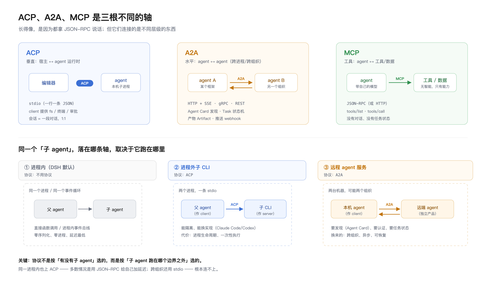
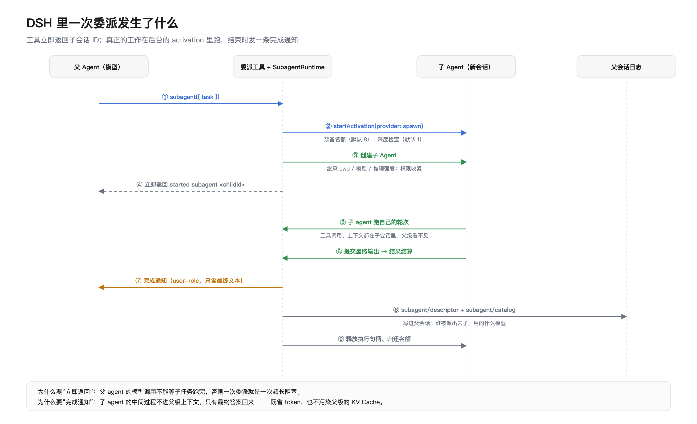

# ACP、A2A 与子 Agent：三根轴，别混用

> 证据来源：ACP v1 schema（`@agentclientprotocol/sdk`）、A2A v1.0.0 规范（<https://a2a-protocol.org/latest/specification/>）、
> 以及本机安装的 DSH `0.2.1-rc.2`：`node_modules/@deepseek-ai/dsh-subagent*`、`dsh-tool-subagent*`、`dsh-acp`。
> 文中所有 DSH 结论都能对应到具体包的 README 与类型定义。

---

## 0. 结论先行

1. **ACP 和 A2A 长得像，是因为都拿 JSON-RPC 2.0 说话；但它们连的是不同层级的东西**——ACP 是"宿主 ↔ agent 运行时"的垂直轴，A2A 是"agent ↔ agent"的水平轴。
2. **子 agent 用不用协议，取决于它跑在哪个边界之外**：同进程不用协议，跨进程用 ACP，跨网络用 A2A。
3. **DSH 的官方子 agent 是进程内的**，走自己的 `ctx.subagents` seam（provider 注册表），**既不是 ACP 也不是 A2A**；ACP 在 DSH 里只出现在"进程外子 agent"这个可选后端上。

---

## 1. 为什么觉得像：五个真相似点

| 相似点 | ACP | A2A |
| --- | --- | --- |
| 线格式 | JSON-RPC 2.0 | JSON-RPC 2.0（还有 gRPC / REST 绑定） |
| 内容模型 | `ContentBlock`（text / image / audio / resource_link / resource） | `Part`（text / raw / url / data） |
| 流式 | `session/update` 单向通知 | `StreamResponse`（SSE：task / message / status_update / artifact_update） |
| 能力协商 | `initialize` 里互报 `clientCapabilities` / `agentCapabilities` | `AgentCard.capabilities`（streaming / push_notifications / extensions） |
| 会停下来等人 | `session/request_permission`、`elicitation/create` | `INPUT_REQUIRED`、`AUTH_REQUIRED` 状态 |
| 出身年代 | 2025，Zed 主导 | 2025，Google 发起并捐给 Linux Foundation |

所以"像"是真的：**同一套 JSON-RPC 骨架、同一套"消息里放结构化片段"的思路、同一个"边跑边推事件"的模式**。但骨架像不等于用途像。

---

## 2. 本质区别：三根轴



*图 1 · 上排是三条协议轴；下排是同一个"子 agent"的三种落法*

### 2.1 逐项对比

| 维度 | **ACP** | **A2A** |
| --- | --- | --- |
| 连接的是谁 | 编辑器/宿主 ↔ **agent 运行时** | **agent ↔ agent**（常常跨组织） |
| 传输 | stdio（NDJSON 为主）、HTTP+SSE、WebSocket | HTTP(S)+JSON-RPC/SSE、gRPC、REST |
| 拓扑 | 1 个宿主 : N 个 agent 进程，**会话级 1:1** | N : N，服务化、多租户 |
| 核心对象 | `session` + `prompt` + `stopReason` | `Task`（带状态机）+ `Message` + `Artifact` |
| 状态模型 | 一轮对话结束就返回 `stopReason`（`end_turn` / `cancelled` / `max_tokens`…） | `SUBMITTED → WORKING → COMPLETED / FAILED / CANCELED / REJECTED`，中途可 `INPUT_REQUIRED` / `AUTH_REQUIRED` |
| 发现机制 | **没有**。宿主直接 spawn，或从 registry 里装 | **Agent Card**：`/.well-known/agent-card.json`，含 skills / capabilities / security schemes |
| 谁能碰文件/终端 | agent **反向请求 client**（`fs/*`、`terminal/*`） | **没有**。远端 agent 只能用自己环境里的东西 |
| 人的授权 | 一等公民：`session/request_permission` + `elicitation/create` | 只有"任务卡在 `INPUT_REQUIRED`"这种状态，怎么问人是实现自由 |
| 认证 | `authenticate`（agent 自己的登录，如 Cursor 的 `cursor_login`） | 组织级：API Key / OAuth2 / OIDC / mTLS，写在 Agent Card 里 |
| 产物 | 内容块 + 结构化 diff（`tool_call.content` 里的 `diff`） | `Artifact`（可多个 Part，可流式追加） |
| 长任务 | 一个 `session/prompt` 请求挂着直到结束；断了靠 `session/load` 恢复 | Task 是持久对象，`SubscribeToTask` 随时接回，`pushNotification` 走 webhook |

### 2.2 一句话概括差异

- **ACP 关心"用户在编辑器里怎么用上 agent"**：所以它必须有文件 buffer、终端、审批——这些是"人的现场"。
- **A2A 关心"两个 agent 怎么协作而不暴露内部"**：所以它必须有 Agent Card（我不认识你，先自报家门）、Task（我不等你，任务是个对象）、Artifact（产出物要能交付）。
- **MCP 关心"agent 怎么用工具"**：所以它只有 `tools/list` 和 `tools/call`，没有对话、没有任务状态。

> A2A 官方文档自己也把话说死了：*"A2A covers agent-to-agent communication; MCP covers agent-to-tool communication. They are complementary."*
> ACP 的位置不在这个二分里，它在**更上面一层**：人和 agent 之间的那层。

### 2.3 三个常见混淆，顺手澄清

| 混淆 | 事实 |
| --- | --- |
| "ACP 是 Google 的 A2A 的竞品" | 不是同一层。ACP 连接编辑器与 agent；A2A 连接 agent 与 agent。ACP 的 agent 完全可以同时是一个 A2A server。 |
| "有了 A2A 就不需要 ACP 了" | 反过来才对：A2A 管不了"用户未保存的 buffer"和"要不要批准这次写文件"。这些只有宿主知道。 |
| "IBM 的 ACP 和这个 ACP 是一回事" | 不是。IBM 的 Agent Communication Protocol 也是 agent 间协议，后来**并入 A2A**、同在 Linux Foundation 下（[ACP joins forces with A2A](https://github.com/orgs/i-am-bee/discussions/5)），和 Zed 的 Agent **Client** Protocol 只是缩写撞了。 |

---

## 3. 子 agent 场景：先问"边界在哪"

同一个"派个子 agent 去干活"，有三种完全不同的落法（见 图 1 下半部分）：

| 形态 | 子 agent 跑在哪 | 用什么通信 | 什么时候选 |
| --- | --- | --- | --- |
| **① 进程内** | 同一进程、同一事件循环 | **不用协议**：函数调用 / 进程内事件总线 | 默认选择。延迟最低、能共享 KV cache、能共享 cwd 与工具作用域 |
| **② 进程外子 CLI** | 另一个进程（本机） | **ACP**（stdio JSON-RPC） | 需要隔离、需要换成别人的实现（Claude Code / Codex / Cursor）、需要崩溃不带走父进程 |
| **③ 远程 agent** | 另一台机器 / 另一个组织 | **A2A** | 跨团队、跨公司、要发现、要异步长任务、要交付物 |

**所以"会不会同时用两个协议"？会，但不是因为"有子 agent"，而是因为你的系统里同时存在两种边界。** 典型组合：

```
你的编辑器 ──[ACP]──► 你的 agent 运行时 ──[A2A]──► 合作方的 agent 服务
                              │
                              └──[进程内]──► 自己的子 agent（不涉及协议）
```

---

## 4. DSH 官方子 agent 插件是怎么实现的

这一节全部基于本机 `@deepseek-ai/dsh@0.2.1-rc.2` 的实际包。

### 4.1 不是一个插件，是六个

| 包 | 角色 |
| --- | --- |
| `dsh-subagent` | **服务定义（seam）**：`ctx.subagents`，一个具名 provider 注册表 + 受管 activation 生命周期 |
| `dsh-subagent-spawn-in-process` | provider `spawn`：**全新**子 agent（空对话） |
| `dsh-subagent-fork-in-process` | provider `fork`：子 agent 以**父级已完成的轮次**作为初始内容 |
| `dsh-tool-subagent` | 面向模型的**委派工具**（`subagent`），指向某个 provider |
| `dsh-tool-subagent-control` | 面向模型的**控制工具**：`send_message` / `interrupt_agent` / `list_agents` |
| `dsh-client-ui-subagent` | 前端渲染子会话（不是协议层） |

这个拆法本身就是一个设计观点：**"能派子 agent"和"怎么派"是两件事**——seam 定义契约，provider 提供实现，工具只是消费者。

### 4.2 核心抽象：一个 seam，多个 provider

`ctx.subagents` 是注册表，provider 通过名字注册：

```ts
export interface SubagentProvider {
  readonly name: string;                       // 'spawn' | 'fork' | 'acp' | ...
  readonly capabilities: SubagentCapabilities; // agentOptions / agentPreset / outputSchema / depthLimit
  readonly inheritsParentContext: boolean;     // fork=true，spawn=false
  readonly agentRouteDefaults?: { provider: string; model: string };
  start?(request: ResolvedSubagentStartRequest): Promise<SubagentRun>;   // 外部一次性执行
}
```

> 关键：**`SubagentCapabilities` 是四个布尔值，不是一个协议版本号。** 请求里要了 provider 没有的能力，`startActivation()` 在创建子级**之前**就拒绝，而不是"先接受了再悄悄忽略"。

最小组合（YAML，来自官方 README）：

```yaml
- name: '@deepseek-ai/dsh-subagent'
- name: '@deepseek-ai/dsh-subagent-spawn-in-process'
- name: '@deepseek-ai/dsh-tool-subagent'
  config:
    provider: spawn
    toolName: subagent
```

### 4.3 spawn 与 fork：只差初始内容，但差在 KV Cache

| | `spawn` | `fork` |
| --- | --- | --- |
| 子级初始内容 | **空**：只有你给的任务提示词 | 父级**已配平的已完成轮次**前缀 + 你的任务 |
| 是否继承父级对话 | 否 | 是（但只到 fork 那一刻，之后父级新增的看不到） |
| 能否看到"进行中的这一轮" | — | **不能**，进行中的轮次永远被排除 |
| 独立选 preset | 支持 | 不支持 |
| 适合 | 自足的子任务（"去查一下 X"） | 延续当前对话（审查、跟进、二次分析） |
| **KV Cache** | 与父级完全独立，重新建立前缀 | **逐字节相同的继承前缀 → 可复用父级的 KV Cache** |

最后一行是这套设计里最"工程"的一处：fork 之所以能用父级历史还便宜，是因为子级的消息定义、工具 schema、系统提示都与父级**逐字节相同**，所以那一段前缀在提供方那边命中缓存。README 明确写了这条不变式，并说明了为什么 fork 不公开"子级单独选模型路由"——一旦路由不同，复用的前提就没了。

### 4.4 一次委派的真实时序



*图 2 · 工具立即返回子会话 ID；工作在后台的 activation 里跑*

用文字再说一遍，因为这里有个容易看漏的点：

1. 模型调用 `subagent({ task })`。
2. `startActivation()` **先预留名额、再检查深度**，然后才创建子 agent（顺序很重要：不能先建再拒）。
3. 工具**立即**返回 `started subagent <childId>`——父级模型调用不等结果。
4. 子 agent 在自己的会话里跑，工具调用、上下文都不进父级。
5. 结束时父级收到一条 **user-role 的完成通知**，只含子级最终文本（非空文本块），推理过程被排除。

### 4.5 五个真正决定行为的机制

| 机制 | 默认值 / 规则 | 为什么这样做 |
| --- | --- | --- |
| **并发容量** | `maxActiveSubagents = 8`（每棵 activation 树共享池，根父级不占名额） | 防止一次委派炸出几十个子 agent 烧额度。超额直接 `ACTIVATION_LIMIT_REACHED`，**不排队**（避免"等子级的父级又在等自己占的名额"死锁） |
| **递归深度** | `maxDepth = 1`（`0` 禁止委派） | 我上一轮说的"递归防护"，这里是官方默认：**子 agent 默认不能再派子 agent** |
| **结果投递** | `delivery: 'parent'` → 模型可见的完成通知；`'caller'` → 工作流自己等结果，不发通知 | 让"父 agent 需要答案"和"程序需要结果"两种消费方式共存 |
| **消息与所有权** | `sendMessage()` 只允许**直接子级 / 直接父级**；`interrupt()` 保留收件箱与后代 | 用邻接关系做权限，比"谁都能给谁发消息"安全得多 |
| **权限收紧** | 子 agent 的运行时上下文里注入一段固定声明 | 见下 |

那段注入的声明值得原文引用（它解释了子 agent 为什么"干了坏事会失败"）：

```text
You are a delegated subagent: your permission scope was fixed when you were started and cannot be widened from inside this session — operations that require approval are rejected automatically. When the job needs access beyond that scope, do not retry the denied operation; state the limitation in your reply so the delegating agent can handle it.
```

**翻译成人话**：子 agent 内部没有弹窗权限，越权操作会被直接拒绝，它必须把限制写在回复里交给父级。这是"进程内子 agent 没有 UI"这个事实的必然结果——它没有审批界面可用。

### 4.6 持久化与可观测：三类记录

| 记录 | 写在哪 | 内容 |
| --- | --- | --- |
| `subagent/descriptor` | 子会话自己的日志 | 用的哪个 provider、哪个模型、什么推理强度——**冷恢复靠它**，且不进模型上下文 |
| `subagent/catalog` | **父会话**日志 | 谁被派出去了（成员关系），不携带执行状态；分块 projection，列表查询不用加载子 agent |
| `subagent/start` / `subagent/end` | 事件总线 | 生命周期成对事件，按委派父级做作用域过滤 |

"列表子 agent 不需要加载子 agent"这一点做得挺狠：目录读取是 O(D) 的日志事件扫描，外部子级是叶子节点，连日志都不用读。

### 4.7 为什么默认不用 ACP

DSH 完全有能力把子 agent 做成进程外 ACP（它确实有个 `dsh-subagent-acp`，见下节），但**默认是进程内**。取舍很清楚：

| 维度 | 进程内（默认） | 进程外 ACP |
| --- | --- | --- |
| 延迟 | 函数调用 | 进程启动 + 握手 + JSON-RPC |
| 可继续对话 | 支持（冷恢复） | **一次性执行**（官方原话：外部子级只暴露一次执行，拒绝继续输入） |
| 上下文共享 | 可 fork，复用 KV cache | 只能把历史塞进 prompt |
| 隔离性 | 无 | 有（崩了不带走父进程、可换实现） |
| 权限模型 | 父级可控的收紧 | 对方自己的权限系统 |

**这就是"协议不是越多越好"的实证**：在同一个进程里，ACP 提供的所有好处（隔离、可替换）你都用不上，而它带来的成本（序列化、生命周期、一次性执行）你全要付。

---

## 5. DSH 里 ACP 到底出现在哪：两个方向

这是个容易忽略的事实——**DSH 同时实现了 ACP 的两端**：

| 包 | 角色 | 原话（README） |
| --- | --- | --- |
| `dsh-acp` | **ACP Server**：把 DSH agent 暴露给外部程序 | *"让受信程序通过标准 ACP 自动操作持久 DSH agent…进程外 subagent、测试运行器与脚本化控制器适合选择它"* |
| `dsh-subagent-acp` | **ACP Client**：进程外子 agent 的 provider（本机未安装，README 中被引用） | *"spawn 并驱动本服务器的进程外 ACP 客户端"*；`dsh-acp` 里写着 *"`dsh-subagent-acp` 会启动同一 profile 来执行进程外委派"* |

也就是说：

```
                     ┌───────────── dsh-acp（ACP Server）─────────────┐
   外部编辑器 ──ACP──►│  DSH agent 会话（持久、可选模型、挂 MCP）        │
                     └────────────────────────────────────────────────┘
                                     ▲
                                     │ 同一条 ACP
                     ┌──────────────┴── dsh-subagent-acp（Client）───┐
                     │ 作为 provider 注册进 ctx.subagents，名字叫 acp │
                     └────────────────────────────────────────────────┘
```

**注意这个闭环**：DSH 可以把自己 spawn 成子 agent（`dsh-subagent-acp` 启动 `dsh-acp` profile），走一遍完整的 ACP 往返。这不是多此一举——它让"进程外隔离"这个后端可以拿自己的实现来测试，等价于一个恒等映射的端到端测试。

而 **A2A 在 DSH 里完全没有**：294 个包里没有一个是 A2A 相关包，全部 README 里也搜不到 A2A 字样（仅有的几处命中是打包产物的 base64 噪声）。原因也简单——DSH 的子 agent 不出进程，不需要跨组织发现与任务状态机。

---

## 6. 选型清单

### 6.1 三个问题定协议

```
子 agent 跑在哪里？
├─ 同一进程 ────────────────► 不用协议（像 DSH 的 spawn/fork）
├─ 本机另一个进程 ──────────► ACP（stdio JSON-RPC）
└─ 另一台机器 ──────────────► A2A（HTTP + Agent Card + Task）
```

### 6.2 如果你要做"ACP 子 agent"，缺什么

DSH 的 dev-note 里已经把坑写在明面上了（`dsh-subagent` README「开发备注」）：

> **可继续 ACP 子级**——需要持久化远程会话 id 与逐子级的继续执行能力声明。

翻成实现清单：

| 你要补的 | 为什么 |
| --- | --- |
| 持久化**远端会话 id** | ACP 的 `session/load` 需要它；否则父级重启后子 agent 变孤儿 |
| 逐子级的"能否继续"能力标记 | DSH 的语义是"本地可继续、外部一次性"，混在一起会让 `send_message` 行为不可预测 |
| 取消传播 | 父级 `session/cancel` 要映射到 `$/cancel_request`，且要等对端真正停下 |
| 容量与深度也要管 | ACP 子 agent 是进程，不吃 `maxActiveSubagents` 的账，得单独算 |

### 6.3 最后一张对照表

| 你想解决的问题 | 该用的协议 | 别用错成 |
| --- | --- | --- |
| 让用户在编辑器里用上 agent，看到 diff、审批、终端 | ACP | A2A（它没有"用户的现场"概念） |
| 让两个团队的 agent 互相派活、交付产物 | A2A | ACP（它没有发现机制，也没有任务对象） |
| 让 agent 调用工具/数据 | MCP | ACP（ACP 的工具能力是"反向请求宿主"，不是通用工具协议） |
| 在自己进程里并行拆任务 | **都不用** | 硬套 ACP：白付序列化与进程成本 |

---

## 7. 参考

- ACP 规范：<https://agentclientprotocol.com>（v1 协议正文、schema、RFD）
- ACP 详解（本仓库）：[`acp-protocol-guide.md`](acp-protocol-guide.md)
- ACP 反向调用与可运行 client（本仓库）：[`acp-reverse-calls.md`](acp-reverse-calls.md)、`acp-client-demo/`
- A2A 规范 v1.0.0：[specification](https://a2a-protocol.org/latest/specification/) ·
  [快速参考](https://a2a-protocol.org/llms-reference.txt) ·
  [Protobuf 真源](https://github.com/a2aproject/A2A/blob/main/specification/a2a.proto)
- DSH 子 agent 实现（本机 `@deepseek-ai/dsh@0.2.1-rc.2`）：
  `dsh-subagent/README.zh.md`、`dsh-subagent-spawn-in-process/README.zh.md`、
  `dsh-subagent-fork-in-process/README.zh.md`、`dsh-tool-subagent/README.zh.md`、
  `dsh-acp/README.zh.md`
